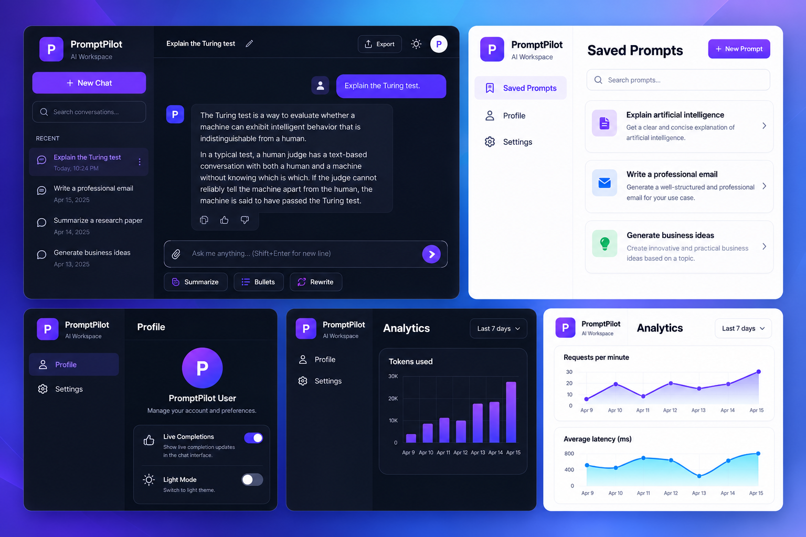
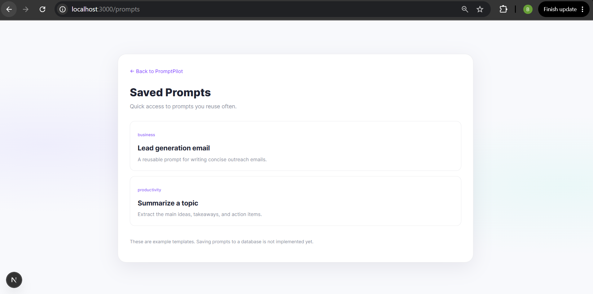
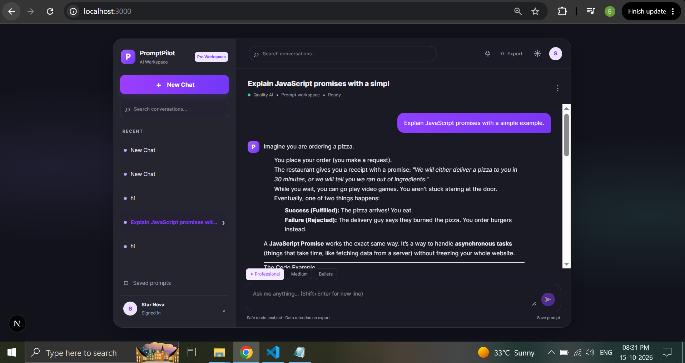
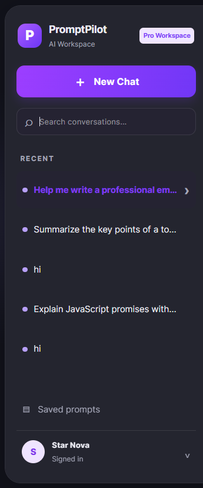
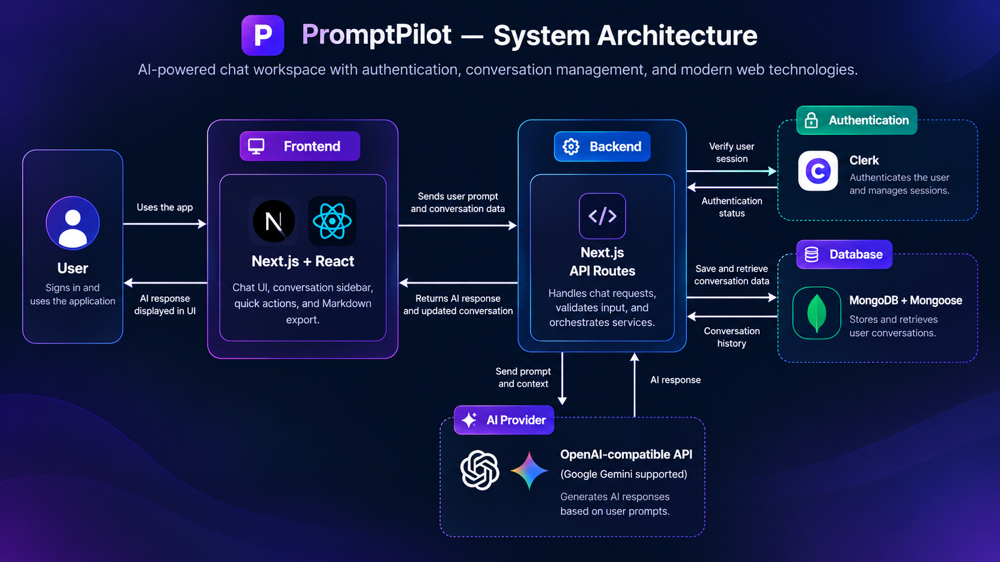
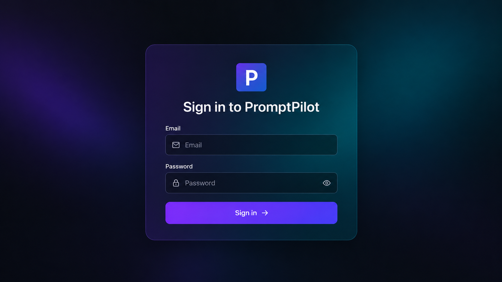

# PromptPilot

**AI-powered chat workspace with conversation history, quick actions, Markdown export, and a modern responsive interface.**

PromptPilot is a Next.js App Router application designed to make AI-assisted writing and conversation management simple. It combines a chat workspace with user authentication, persistent chat history, and an OpenAI-compatible API integration.

> **Project status:** This README describes the current implementation. The Saved Prompts page currently contains example templates; persistent prompt saving and a real analytics backend are not implemented. The analytics and sign-in concept images are included as visual design references, not as proof of implemented functionality.

## ✨ Features

- **AI chat workspace** — send prompts and view assistant responses.
- **Conversation management** — create and manage conversations using the available chat controls.
- **Markdown responses** — display formatted AI responses.
- **Quick actions** — prompt helpers such as Summarize, Rewrite, and Bullets where available in the interface.
- **Markdown export** — export a conversation to a Markdown file.
- **Authentication** — Clerk integration for user sign-in and session handling.
- **Persistent chat history** — MongoDB with Mongoose stores conversations.
- **Theme-aware interface** — modern dark UI with theme controls.
- **Saved Prompts page** — currently displays sample prompt templates; saving templates to a database is not implemented yet.

## 🖥️ UI Previews

### Full UI Showcase



### Main Chat Workspace



### New Chat Screen



### Saved Prompts Page



### System Architecture



### Sign-In Screen Concept



The dashboard showcase and sign-in image are design previews. Actual UI screenshots are also included above so visitors can distinguish the current app from concept artwork.

## 🧰 Tech Stack

| Layer | Technology | Purpose |
|---|---|---|
| Frontend | Next.js, React | App routing and interactive UI |
| Styling | Project styling and CSS | Layout, theme, and responsive presentation |
| Authentication | Clerk | User authentication and session handling |
| Backend | Next.js Route Handlers | Chat and conversation API endpoints |
| Database | MongoDB, Mongoose | Persistent conversation storage |
| AI integration | OpenAI SDK with an OpenAI-compatible API | Generate assistant responses |
| Code quality | ESLint | Linting |

Exact package versions are defined in `package.json` and `package-lock.json`.

## 🏗️ Architecture

1. The user interacts with the PromptPilot chat interface.
2. The client sends a request to a Next.js API route.
3. The server checks the user's Clerk authentication.
4. MongoDB stores and retrieves conversation history.
5. The server sends the prompt and recent conversation context to the configured AI provider.
6. The response is saved and returned to the client for display.

```text
User
  |
  v
Next.js + React UI
  |
  v
Next.js API Route
  |----------> Clerk (authentication)
  |----------> MongoDB + Mongoose (conversation history)
  |
  v
OpenAI-compatible AI provider
  |
  v
Assistant response -> saved conversation -> UI
```

Responses are currently requested as complete responses; token-by-token server streaming is not implemented.

## ⚙️ Requirements

- Node.js 18.18 or newer (Node.js 20 LTS recommended)
- npm
- A Clerk application
- A MongoDB connection string
- An API key for a supported OpenAI-compatible AI provider

## 🚀 Run Locally

1. Clone your repository or download the project.
2. Open a terminal in the folder that contains `package.json`.
3. Install dependencies:

   ```bash
   npm ci
   ```

4. Create `.env.local` from the example file.

   **PowerShell:**
   ```powershell
   Copy-Item .env.example .env.local
   ```

   If `.env.local` already exists, do not overwrite it; edit the existing file instead.

5. Add the environment variables listed below.
6. Start the development server:

   ```bash
   npm run dev
   ```

7. Open [http://localhost:3000](http://localhost:3000).

## 🔐 Environment Variables

Add these variables to `.env.local` and replace the example values with your own credentials:

```env
NEXT_PUBLIC_CLERK_PUBLISHABLE_KEY=your_clerk_publishable_key
CLERK_SECRET_KEY=your_clerk_secret_key
MONGODB_URI=your_mongodb_connection_string
OPENAI_API_KEY=your_ai_provider_api_key
OPENAI_BASE_URL=https://generativelanguage.googleapis.com/v1beta/openai/
OPENAI_MODEL=gemini-2.5-flash
```

The `OPENAI_BASE_URL` and `OPENAI_MODEL` values above are an example for Google's OpenAI-compatible Gemini API. Use a base URL and model that are currently supported for your account. For OpenAI, use the appropriate OpenAI API key and model instead.

**Security:** Never commit `.env.local`, API keys, database credentials, or Clerk secret keys. The project `.gitignore` should exclude `.env*`. If a credential has been exposed, revoke or rotate it in the provider dashboard.

👩‍💻 Author

Bushra Inamdar

Computer Engineering Graduate | Full-Stack Developer

GitHub: @bush07

Project Repository: PromptPilot
